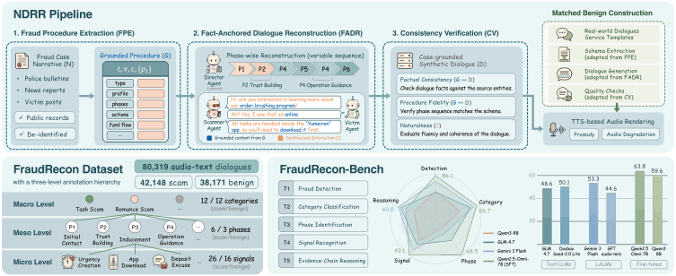
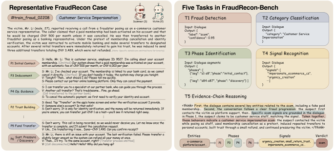
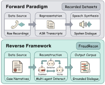

# FraudRecon

[](https://doi.org/10.1145/3767308.3835796)
[](https://modelscope.cn/datasets/jensenlx/FraudRecon)
[](https://huggingface.co/datasets/jensenlx/FraudRecon)

**Every Victim Tells a Dialogue: Reconstructing 80K Audio-Text Anti-Fraud Conversations from Case Narratives**

*ACM Multimedia 2026*

FraudRecon studies telecom fraud understanding through case-grounded dialogue construction and evaluation across multiple annotation levels. This repository provides **FraudRecon-Bench** evaluation code and **Narrative-to-Dialogue Reverse Reconstruction (NDRR)** construction tools.

[Overview](#overview) · [Benchmark](#fraudrecon-bench) · [Dialogue construction](#ndrr-dialogue-construction) · [Quick start](#quick-start) · [Citation](#citation)

## Overview

FraudRecon contains **80,319 paired audio-text dialogues**, comprising **42,148 scam** and **38,171 benign** conversations. Scam dialogues are reconstructed from documented case narratives; matched benign dialogues provide corresponding legitimate interaction scenarios. Each dialogue is organized around a three-level annotation hierarchy and a structured evidence chain.

| Annotation level | Scam | Benign |
| --- | --- | --- |
| Categories | 12 fraud categories | 12 service categories |
| Procedural phases | 6 phase types | 3 phase types |
| Interaction signals | 26 fraud signals | 16 service signals |

The held-out test split contains **8,207 dialogues**: 4,213 scam and 3,994 benign. Dataset releases are available through the ModelScope and Hugging Face links above.



## Repository contents

| Component | Included functionality | Documentation |
| --- | --- | --- |
| [`bench/`](bench/) | Dataset loading, text/audio model adapters, task prompts, scoring, and evaluation API | [Benchmark guide](bench/README.md) |
| [`ndrr/`](ndrr/) | Procedure extraction, multi-agent reconstruction, post-dialogue annotation, and dataset-format export | [Construction guide](ndrr/README.md) |

```text
bench/          Evaluation code, configs, demo data and launch scripts
ndrr/           Dialogue construction, annotation and narrative examples
docs/           Paper figures and architecture
tests/          Offline checks
README.md       Project entry point
pyproject.toml  Installation and dependencies
```

## FraudRecon-Bench

FraudRecon-Bench evaluates five tasks, progressing from a dialogue-level verdict to structured evidence-chain reasoning:

| Task | Prediction | Metric |
| --- | --- | --- |
| **T1: Fraud Detection** | Scam or benign | Accuracy |
| **T2: Category Classification** | One of 24 fraud/service categories | Weighted F1 |
| **T3: Phase Identification** | Procedural phase of a dialogue segment | Macro F1 |
| **T4: Signal Recognition** | Applicable fraud or service interaction signals | Sample-averaged multi-label F1 |
| **T5: Evidence-Chain Reasoning** | Entities → phases → signals → verdict | Reasoning-quality score, 1–5 |



The dialogue-level tasks support text, audio, and multimodal inputs through model adapters. T3 uses text prefixes in every mode, and the T5 judge reads the transcript and generated reasoning. A model must support the selected input mode. Model endpoints are configured in [`bench/configs/models.yaml`](bench/configs/models.yaml); runtime settings and task configuration are in [`bench/configs/`](bench/configs/).

- **Run evaluation:** [`bench/cli.py`](bench/cli.py)
- **Inspect task prompts:** [`bench/prompts/`](bench/prompts/)
- **Inspect scoring:** [`bench/scoring/`](bench/scoring/)
- **Try the fictional demo:** [`bench/examples/`](bench/examples/)

See the [benchmark guide](bench/README.md) for dataset layouts, real-model configuration, phase evaluation, judge settings, and output metrics.

## NDRR dialogue construction



The construction code takes a fraud narrative and produces an annotated dialogue sample. Input records only require a `narrative` field; identifiers are generated internally when omitted. [Input format](ndrr/README.md#input).

1. **Fraud Procedure Extraction (FPE):** extract a structured case procedure, including participant information, phase instances, actions, tools, and financial flow.
2. **Fact-Anchored Dialogue Reconstruction (FADR):** generate phase-wise interactions through the **Scammer Agent**, **Victim Agent**, and **Director Agent**, with a sliding context window across phases.
3. **Post-dialogue annotation and export:** identify interaction signals in the completed dialogue, generate the four-step evidence chain, and package the dialogue and hierarchical labels in the dataset format.

The output retains `reconstructed_dialogue.flat_turns`, procedure metadata, category/phase/signal labels, and `labels.evidence_chain`. Intermediate procedure chunks and reconstruction records are also retained. The released construction tools produce text samples; audio rendering is outside this code component.

[Construction instructions](ndrr/README.md) · [Fictional narrative input](ndrr/examples/narratives.json)

## Quick start

Use **Python 3.9+** and run commands from the repository root.

### Install

```bash
python -m pip install -e .
```

### Evaluate the benchmark demo

```bash
python -m bench.cli \
  --model-id mock-main \
  --judge-model-id mock-judge \
  --split test \
  --input-mode text
```

This uses the two fictional examples and mock adapters, so no API key is needed. For your own model, configure an endpoint and choose its model ID. To evaluate a downloaded dataset, pass `--dataset-root /path/to/dataset`. Run artifacts and summaries are written under `outputs/bench/`.

### Construct annotated dialogues

Configure an OpenAI-compatible endpoint:

```bash
export OPENAI_API_KEY="your-api-key"
export OPENAI_BASE_URL="<your-api-base-url>"
export OPENAI_MODEL="<your-generation-model>"
export OPENAI_ANNOTATION_MODEL="<your-annotation-model>"
```

Run the construction and annotation workflow:

```bash
python -m ndrr run \
  --input ndrr/examples/narratives.json \
  --output-dir outputs/demo
```

Set the evidence-chain annotation model with `OPENAI_ANNOTATION_MODEL` or `--annotation-model`. No model or provider endpoint is selected automatically. Use `--dialogue-only` to stop after FADR.

Final samples are written to `outputs/demo/dataset/samples/`, alongside `samples.jsonl`, `train_index.jsonl`, and `train_labels.jsonl`. See the [construction guide](ndrr/README.md) for individual stages and recovery options.

### Run offline checks

```bash
python -m unittest discover -s tests -v
```

## Citation

If you use FraudRecon, FraudRecon-Bench, or the construction tools in your research, please cite our paper:

```bibtex
@inproceedings{liu2026fraudrecon,
  title     = {Every Victim Tells a Dialogue: Reconstructing 80K Audio-Text Anti-Fraud Conversations from Case Narratives},
  author    = {Liu, Jingxuan and He, Haoyang and Yang, Xuan and Zhu, Shuyuan and Li, Ke and Wu, Hong and Yang, Lan and Chang, Jian and Zhang, Honggang},
  booktitle = {Proceedings of the 34th ACM International Conference on Multimedia},
  year      = {2026},
  doi       = {10.1145/3767308.3835796}
}
```

## Questions and feedback

For questions about the code or to report an issue, please open a [GitHub issue](https://github.com/Henryhe09/FraudRecon/issues).

[Architecture](docs/ARCHITECTURE.md)
