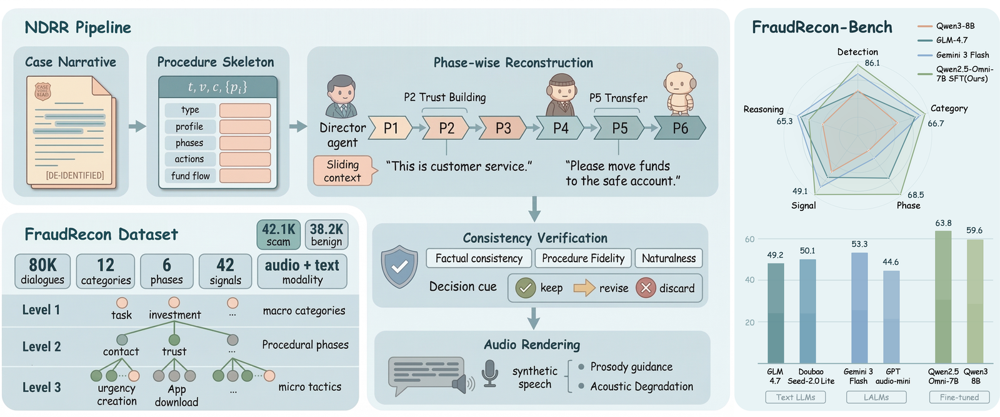
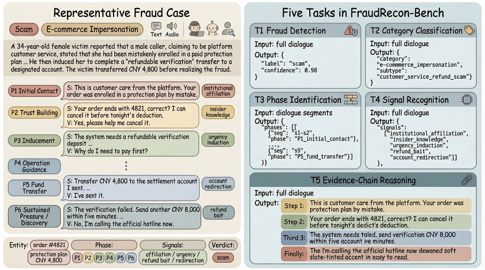

# FraudRecon-Bench

This repository provides the benchmark and evaluation framework for **FraudRecon**, a multi-granularity audio-text benchmark for telecom fraud understanding introduced in our paper. The benchmark is designed to evaluate model capability from coarse fraud judgment to structured evidence-chain reasoning.

> **Release Status:** This repository provides the evaluation framework, configuration files, documentation, and a minimal demo split for smoke testing. The full FraudRecon dataset, including both training and test splits, is now available on [ModelScope](https://www.modelscope.cn/datasets/jensenlx/FraudRecon).



## Overview

FraudRecon is built on **Narrative-to-Dialogue Reverse Reconstruction (NDRR)**, a pipeline that reconstructs fact-anchored scammer-victim dialogues from real-world fraud case narratives. Following the paper, the benchmark covers five tasks:

- `T1` Fraud Detection
- `T2` Category Classification
- `T3` Phase Identification
- `T4` Interaction Signal Recognition
- `T5` Evidence-Chain Reasoning

The current evaluation code organizes these tasks into three execution stages:

- `Round 1`: full-dialogue evaluation for `T1 + T2 + T4`
- `Round 2`: prefix-based phase evaluation for `T3`
- `Judge`: reasoning-quality scoring for `T5`

This runtime decomposition is implementation-oriented only; the benchmark definition remains fully aligned with the paper.



## Paper-to-Code Alignment

This repository has been cleaned and aligned to the paper specification:

- The benchmark task numbering now follows the paper definition consistently.
- Fraud-phase labels are normalized to the paper schema:
  `initial_contact`, `trust_building`, `inducement`, `operation_guidance`, `fund_transfer`, `sustained_pressure_discovery`
- Benign dialogue phases follow the paper schema:
  `opening`, `core_service`, `closure`
- Older internal aliases such as `discovery`, `sustained_pressure`, and `service_handling` are still accepted for backward compatibility.
- Hard-coded internal paths and embedded API keys have been removed from the public-facing configuration.

## Project Structure

```text
.
  app/                    # evaluation engine, adapters, prompts, scoring, API
  configs/                # model, runtime, and task configuration
  data/FraudRecon-Bench/  # dataset placeholder and demo split
  assets/                 # figures used in this README
  scripts/                # helper scripts for local API / worker / vLLM launch
  runs/                   # run artifacts
```

## Dataset Location

By default, the evaluation framework expects the dataset under:

```text
./data/FraudRecon-Bench
```

This default is defined in [`configs/runtime.yaml`](configs/runtime.yaml).

The loader supports either of the following layouts:

```text
data/FraudRecon-Bench/
  test_index.jsonl
  test_labels.jsonl
  samples/
    <case_id>.json
  audio/
    ...
```

or

```text
data/FraudRecon-Bench/
  test/
    test_index.jsonl
    test_labels.jsonl
    samples/
      <case_id>.json
    audio/
      ...
```

Each sample is expected to provide:

- `test_index.jsonl`: case list with `case_id`
- `test_labels.jsonl`: labels including `is_fraud`, `level_1_category`, `level_2_phases`, and `level_3_signals`
- `samples/<case_id>.json`: dialogue content with `reconstructed_dialogue.flat_turns`

This repository currently includes a minimal demo split for smoke testing only. Replace it with the actual benchmark release files when preparing the final public release.

## Quick Start

### 1. Install dependencies

```bash
pip install -r requirements.txt
```

### 2. Verify the repository with the built-in demo split

```bash
python -m app.cli --model-id mock-main --judge-model-id mock-judge --split test --input-mode text
```

### 3. Run evaluation with your own OpenAI-compatible model

First, edit [`configs/models.yaml`](configs/models.yaml) and add or modify a model entry with:

- `base_url`
- `api_key_env`
- `model_name`

Then run:

```bash
python -m app.cli --model-id <your-model-id> --judge-model-id <your-judge-id> --split test --input-mode text
```

For multimodal or audio evaluation, ensure that audio files are present under the dataset root and switch `--input-mode` to `audio` or `multimodal`.

### 4. Optional: start the local API service

```bash
powershell -ExecutionPolicy Bypass -File .\scripts\start_api.ps1
```

## Output Metrics

The batch summary exposes paper-aligned metrics:

- `T1_detection_accuracy`
- `T2_category_weighted_f1`
- `T3_phase_macro_f1`
- `T4_signal_macro_sample_f1`
- `T5_reasoning_score_5_avg`

Legacy summary aliases are still retained in JSON outputs for compatibility with earlier internal scripts.

## Configuration

- [`configs/runtime.yaml`](configs/runtime.yaml): dataset root, default split, retry policy, artifact paths
- [`configs/models.yaml`](configs/models.yaml): model endpoints and model profiles
- [`configs/eval_tasks.yaml`](configs/eval_tasks.yaml): task grouping and judge configuration
