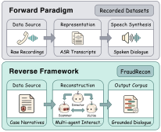

# NDRR

Construct annotated dialogues from fraud narratives. Run commands from the repository root.

## Input

Only `narrative` is required in the input JSON array:

```json
[
  {"narrative": "A fraud case narrative..."}
]
```

Optional fields:

| Field | Purpose |
| --- | --- |
| `case_id` | Your sample identifier; otherwise generated as `case_000001`, `case_000002`, etc. |
| `category` | Known fraud category; otherwise taken from the FPE result |

See [examples/narratives.json](examples/narratives.json) for a complete input example.

## Run

```bash
python -m ndrr run --input ndrr/examples/narratives.json --output-dir outputs/demo
```

Set `OPENAI_API_KEY`, `OPENAI_BASE_URL`, `OPENAI_MODEL`, and `OPENAI_ANNOTATION_MODEL`. The [environment template](.env.example) lists these settings; load them into your shell before running.

Use `--annotation-model` to select the evidence-chain model, or `--dialogue-only` to stop after FADR.

## Individual stages

```bash
python -m ndrr fpe --input ndrr/examples/narratives.json --output outputs/demo/fraud_results_chunks
python -m ndrr fadr --input "outputs/demo/fraud_results_chunks/fraud_results_part_*.json" --output outputs/demo/results/reconstructed_dialogues.jsonl
python -m ndrr.export --input outputs/demo/results/reconstructed_dialogues.jsonl --procedures "outputs/demo/fraud_results_chunks/fraud_results_part_*.json" --output-dir outputs/demo/annotations/input
python -m ndrr.annotation.annotate_signals --input outputs/demo/annotations/input/samples.jsonl --output outputs/demo/annotations/signals.jsonl
python -m ndrr.annotation.annotate_evidence_chain --input outputs/demo/annotations/signals.jsonl --output outputs/demo/annotations/evidence_chain.jsonl --max-workers 2
python -m ndrr.export --input outputs/demo/results/reconstructed_dialogues.jsonl --procedures "outputs/demo/fraud_results_chunks/fraud_results_part_*.json" --annotations outputs/demo/annotations/evidence_chain.jsonl --signal-labels outputs/demo/annotations/signals.jsonl --output-dir outputs/demo/dataset
```

## Code structure

```text
ndrr/
  cli.py                       Pipeline command
  inputs.py                    Narrative fields and internal IDs
  fpe/
    extract.py                 Extraction requests, batching and chunk output
    prompts.py                 Extraction prompts
    config.py                  Extraction settings
  fadr/
    reconstruct.py             Multi-agent reconstruction entry
    reconstruct_single_llm.py  Single-model alternative
    agents/                    Scammer, Victim and Director agents
    logic/                     Dialogue coordination and context window
    utils/                     Model client
    config.py                  Reconstruction settings
  annotation/
    annotate_signals.py        Interaction-signal annotation
    signal_prompts.py          Signal annotation prompts
    signal_rules.txt           Interaction-signal definitions
    annotate_evidence_chain.py Four-step evidence-chain annotation
    evidence_chain_prompts.py  Evidence-chain prompts
    merge_evidence_chain.py    Standalone annotation merge utility
  export.py                    Dataset-format packaging
  examples/                    Fictional inputs
```

Standalone FADR commands require an input pattern and an output path (or explicit `RECON_INPUT_PATTERN` / `RECON_OUTPUT_JSONL` environment settings). Per-case JSON output is placed beside the specified JSONL file unless `--full_output_dir` is supplied. Evidence-chain annotation reads historical procedure chunks only when `--source-chunk-dir` is explicitly supplied.

## Outputs

FPE writes procedure chunks under `fraud_results_chunks/`. FADR writes `results/reconstructed_dialogues.jsonl` and per-case files. Annotation inputs and results are in `annotations/`; `dataset/` is updated after signal and evidence-chain annotation succeed and validate. Individual files are replaced atomically.

Final samples contain `reconstructed_dialogue`, `fraud_meta.structured_procedure`, and `labels` with category, phase, signal and evidence-chain annotations. Audio paths are empty.

## Resume

- **FPE:** resumes by input index; previously recorded errors are skipped as well.
- **FADR:** use `--resume`, with `--retry-errors` to retry failed records.
- **Signal annotation:** successful cases are saved immediately. Use `--resume` to reuse them by `case_id`; changed sample inputs are rejected.
- **Evidence-chain annotation:** resumes by index; use `--retry-errors` to retry failures.

For the combined workflow, rerun with `--resume`; add `--retry-errors` to retry FADR and evidence-chain failures. Existing reconstruction output requires `--resume`. Export uses the latest reconstruction record for each input case.

Keep input ordering and model settings stable when resuming. Use a new output directory for different input or a different annotation model. `--reconstruction-max-cases` limits FADR only.



